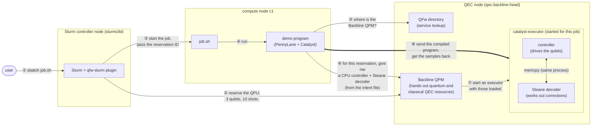
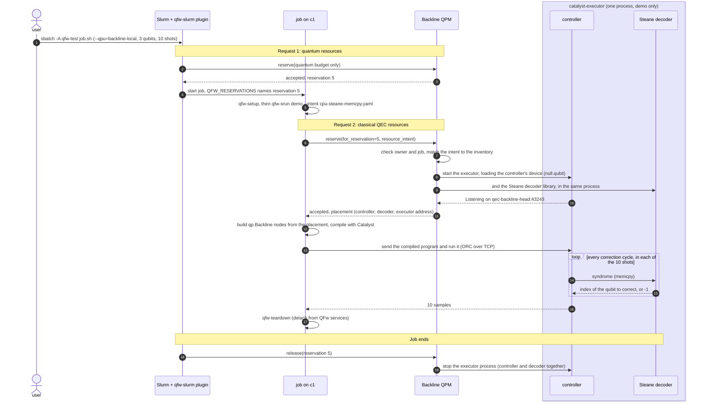
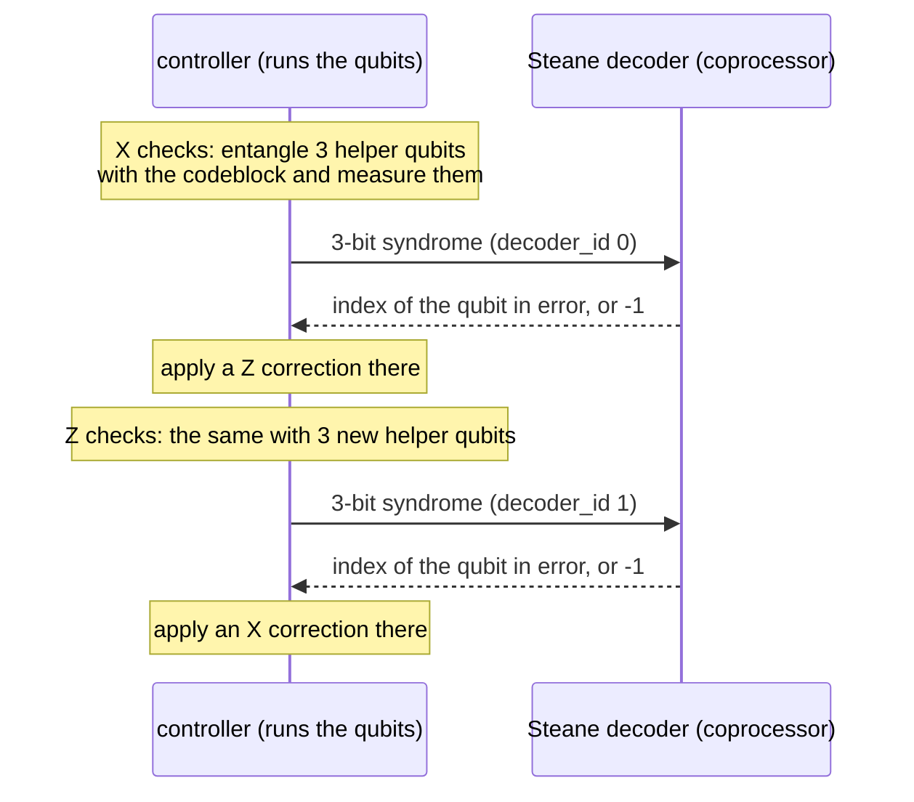
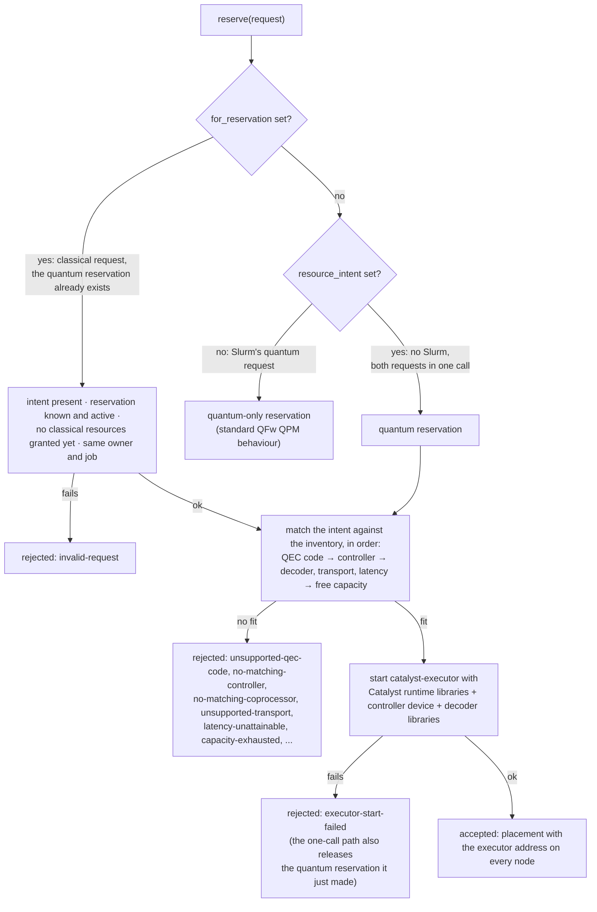
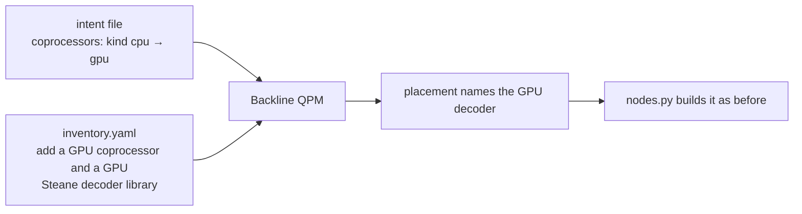

# qri-backline: a Backline QEC demo on QFw

This demo runs a quantum error correction (QEC) program, written with
PennyLane, Catalyst and Backline, on QFw (Quantum Framework, ORNL's framework
for running quantum work on HPC clusters). The cluster schedules jobs with
Slurm.

A user submits one Slurm job. It asks for two kinds of resources:

1. **Quantum resources**, i.e. a reservation on the `backline-local` QPU.
   The reservation is a budget: how many circuits,
   qubits and shots the job may use. QFw and qfw-slurm, the Slurm plugin that
   connects Slurm to QFw, already support this with `#SBATCH --qpu=...`.
2. **Classical QEC resources**, i.e. the classical hardware and software that
   QEC needs next to the qubits:
   - a **controller**, i.e. the process that drives the qubits;
   - a **QEC decoder**, i.e. the code that reads the error measurements and
     works out the corrections;
   - the **transport** between them, i.e. how they pass data.

   The program asks for these in a small intent file. This is what this work
   adds.

Both requests go to the **Backline QPM** (Quantum Platform Manager). In QFw,
every quantum backend has a QPM: the service that decides who may use that
backend and when. The Backline QPM is a new one, added by this work. Besides
the usual quantum reservation, it hands out the classical QEC resources. It
grants them by starting a `catalyst-executor` for the reservation, i.e.
Catalyst's remote-execution server. At startup the executor loads the
controller's device library and the decoder libraries. The program compiles
itself locally, then executes remotely on the executor: over RPC (remote
procedure call), it links the compiled code into the executor's memory and
calls it there.

In this demo, the controller and the Steane decoder run in one process on the
executor and pass data with local memory copy (memcpy), i.e. no network in
between. This setup is only for the demo. In a real system, the controller and
the coprocessors that run the decoders are separate pieces of QEC hardware,
possibly on different machines. They would exchange data over a low-latency
network using RDMA, e.g. RoCE (RDMA over Converged Ethernet), so that data
moves directly between their memories without going through the operating
system. The transport in the intent would then ask for RDMA instead of memcpy.

The hardware choices are also only for the demo. Here the controller runs on
the CPU, and the decoder is for the Steane code, a standard 7-qubit QEC code,
and also runs on the CPU. In a real system the controller could run on an FPGA
and the decoder on a GPU. The program asks for these through the same intent
file, by changing the hardware kinds it requests.

## Run it

The demo runs on the QFw Slurm cluster. The QFw and cluster changes are on the
`backline-qpm` branches of
[josephleekl/QFw](https://github.com/josephleekl/QFw/tree/backline-qpm), which
adds the Backline QPM, and
[josephleekl/QFw-SLURM-Cluster](https://github.com/josephleekl/QFw-SLURM-Cluster/tree/backline-qpm),
which adds the QEC node and `--qpu=backline-local`.

1. Set up the cluster once, as described in
   [`docs/backline.md`](https://github.com/josephleekl/QFw-SLURM-Cluster/blob/backline-qpm/docs/backline.md)
   on the cluster branch. This also installs what the program needs:
   Python 3.12, `pennylane-catalyst==0.16.0b1`, PennyLane and
   PennyLane-Lightning `0.46.0b1`, and a clone of this repository.
2. Submit the job as a cluster user:

       sbatch -A <account> /workspace/qfw-container-base/qri-backline/examples/job.sh

   qfw-slurm requires a Slurm account; the cluster's test users use
   `qfw-test`.

## The pieces

The numbers on the arrows are the order things happen in. Each one is
explained below the diagram.



1. **① Submit.** The user submits `job.sh` with `sbatch -A qfw-test`, i.e.
   Slurm's batch-submit command, charged to the Slurm account `qfw-test`. The
   job's `#SBATCH --qpu=backline-local` lines ask for quantum resources.
2. **② Quantum request.** Before the job starts, Slurm's qfw-slurm plugin
   reserves the QPU's quantum budget on the Backline QPM. This is the
   existing qfw-slurm flow, unchanged.
3. **③ Start the job.** Slurm starts the job on compute node c1. The
   reservation's ID is passed in the `QFW_RESERVATIONS`
   environment variable.
4. **④ Run.** `job.sh` attaches to the QFw services already running on the
   cluster (`qfw-setup`). It then runs the demo program with `qfw-srun`, i.e.
   QFw's wrapper around Slurm's `srun`.
5. **⑤ Find the QPM.** The program asks QFw's directory service, i.e. the
   registry of running QFw services, where the Backline QPM is.
6. **⑥ Classical request.** This is the step this work adds. The program sends
   the QPM another `reserve` call that points at the existing reservation. It
   carries the intent file: a CPU controller, a CPU Steane decoder and memcpy
   between them. The QPM checks that the caller owns the reservation, i.e. the
   same user and Slurm job. It then matches the intent against what the site
   has, i.e. the site inventory in `inventory.yaml`.
7. **⑦ Start the executor.** The QPM starts a `catalyst-executor` with the
   chosen controller and decoder loaded. It returns the **placement**, i.e.
   which controller and decoder were chosen plus the executor's address.
8. **⑧ Run the program.** The program compiles itself with Catalyst on c1. It
   sends the compiled program to the executor and gets the 10 samples back.
   The controller and decoder talk to each other in-process over memcpy.

Steps ②, ⑤ and ⑥ use DEFw (Distributed Execution Framework), i.e. QFw's RPC
layer. QRI (Quantum Resource Interface), i.e. the interface programs use to
reach QPMs, runs on top of it. Step ⑧ uses a different RPC: ORC (On-Request
Compilation), i.e. LLVM's just-in-time compilation library. Its remote mode
lets the program allocate memory in the executor, copy the compiled code in and
call its entry function, all over TCP.

When the job ends, Slurm releases the reservation and the QPM stops the
executor.

| Piece | Where it lives | What it does |
| --- | --- | --- |
| `examples/job.sh` | qri-backline | The `#SBATCH --qpu` lines make the quantum request. The job attaches to the site's QFw services and runs the demo. |
| `intents/cpu-steane-memcpy.yaml` | qri-backline | The classical request: a CPU controller, a CPU Steane decoder and memcpy. |
| `demo_qri_1_local_memcpy.py` | qri-backline | Makes the classical request, prints what was requested and granted, and runs the program. |
| `qfw_qpm.py`, `nodes.py` | qri-backline | Reach the QPM over QRI, and turn its placement into `qp.Backline` nodes, i.e. the PennyLane objects for the controller and decoder. |
| `services/svc_backline_qpm` | QFw, branch `backline-qpm` | The QPM. It matches intents against the inventory, starts and stops executors, and checks the owner and job. |
| `inventory.yaml` | QFw, same branch | What the site offers: controllers, coprocessors (i.e. the hardware a decoder runs on), decoders and transports. |
| `qec-backline-head`, `--qpu=backline-local` | QFw-SLURM-Cluster, branch `backline-qpm` | The node, the Slurm resource, the environment module (i.e. `module load backline`) and the service definition. |

## One job, start to finish

The same flow as a timeline, with the real values from the cluster run. The
box on the right is the one `catalyst-executor` process. The controller
and the decoder are separate parts inside it: the controller runs the compiled
quantum program, and the decoder is the Steane decoder library. In this demo
they share the process so that memcpy works. In a real system they would be
separate processes or machines, connected over RDMA.



What the job prints, from the cluster run (job 9):

```
[quantum]   reservation 5 on backline-local: 1 circuit, ≤3 logical qubits, ≤10 shots   (requested via Slurm)
[classical] requested: controller cpu · decoder cpu (steane) · transport memcpy   (requested by this program)
[classical] granted:   controller local-cpu-ctrl · decoder local-cpu-coproc · executor qec-backline-head:43243
[run]       Steane-encoded GHZ, 10 shots, decoded in real time on the reserved decoder
samples: 10 × [0 0 0]
```

The next section explains what the program computes, and why every sample is
`[0 0 0]`.

## What the program does

The demo is the GHZ example from the Backline paper, [*Python in the front,
party in the Backline*](https://arxiv.org/abs/2609.09270) (Listing 3). The
user writes a plain 3-qubit circuit with no error correction in it:

```python
qp.Hadamard(0)
qp.CNOT([0, 1])
qp.CNOT([1, 2])
return qp.sample([qp.measure(0), qp.measure(1), qp.measure(2)])
```

On ideal qubits this prepares the GHZ state, i.e. (|000⟩ + |111⟩)/√2, so each
shot measures either `000` or `111`.

These 3 qubits are **logical qubits**, i.e. the qubits the program sees. The
QEC is added by the Catalyst compiler, not by the user. The placement names
`qec_code: steane`, and that makes Catalyst run an encoding chain of compiler
passes on the circuit while compiling it:

```mermaid
flowchart LR
    a["logical circuit<br/>H, CNOT, CNOT,<br/>3 measurements"]
    b["each logical qubit<br/>becomes a Steane<br/>codeblock"]
    c["a correction cycle after<br/>each codeblock is prepared<br/>and after every gate"]
    d["simulated noise<br/>before each cycle"]
    e["logical gates become<br/>physical gates on<br/>7 qubits each"]
    f["each decode becomes<br/>a transport round<br/>to the decoder"]
    a -- "convert-quantum-to-qecl" --> b --> c
    c -- "inject-noise-to-qecl" --> d
    d -- "convert-qecl-to-qecp,<br/>convert-qecp-to-quantum" --> e
    e -- "lower-decode-to-transport" --> f
```



1. **Encode.** Each logical qubit becomes a codeblock of 7 physical qubits,
   prepared in the encoded |0⟩ state. The Steane code is a standard 7-qubit
   code that corrects any single-qubit error in a codeblock.
2. **Add correction cycles.** The compiler adds a QEC cycle, i.e. one round of
   error correction, on each codeblock after it is prepared and after every
   logical gate. A CNOT gets a cycle on both of its codeblocks.
3. **Inject noise.** Before each cycle, `inject-noise-to-qecl` inserts a
   simulated error: a random rotation on one random physical qubit of the
   codeblock. The paper describes this as "the noise model used by the
   demonstrations". The qubit and the angles are chosen at compile time.
4. **Expand gates.** Each logical gate becomes physical gates, i.e. it is
   applied *transversally*, gate by gate across the 7 qubits. A logical
   Hadamard is a Hadamard on each of the 7 qubits. A logical CNOT is 7 CNOTs
   between matching qubits of the two codeblocks. A logical measurement
   measures all 7 qubits and works out the logical result from their parity.
5. **Send decodes to the decoder.** `lower-decode-to-transport` replaces each
   decode in a cycle with a **transport round**, i.e. the controller sends the
   syndrome to the decoder and waits for the answer. Without a Backline
   placement the decode stays in the program, so the same encoded program also
   runs without a coprocessor.

One correction cycle on one codeblock, as it runs on the executor:



A **syndrome** is the result of the stabilizer measurements, i.e. parity
checks that reveal an error without measuring the encoded state itself. The
Steane code checks X and Z errors separately, so each cycle makes two decodes.
The Steane decoder is a lookup table: each 3-bit syndrome points to the one
qubit that needs correcting. The Backline paper measures one such round trip at
2.3 µs (median) from an FPGA controller to a CPU decoder. Here it is a memcpy
inside one process.

**Why every sample is `[0 0 0]`.** The controller's device is `null.qubit`,
i.e. a Catalyst test device that does no simulation and always measures 0.
Every syndrome is therefore 000, the decoder answers "no error" each time, and
every logical measurement reads 0. The run exercises the whole path: the
encoding, every transport round and the decoder. It is not a physics result.
With a simulating device instead, e.g. `lightning.qubit`, each shot should read
`000` or `111`, with the injected errors corrected along the way.

## How the QPM handles a reserve

Every request reaches the QPM as a `reserve` call. Two fields in the request
decide what kind of request it is:
- `for_reservation`, i.e. an existing reservation the request is for;
- `resource_intent`, i.e. the contents of the intent file.



In the match, **latency** means the decoder's measured round-trip time, which
is checked against the limit in the intent. **Free capacity** means an
inventory entry that isn't already granted to another reservation.

An executor stops in any of these cases:
- the reservation is released;
- the QPM shuts down;
- the QPM process gets SIGTERM, which `qfw-teardown` and
  `qfw-site-services stop` send.

## Swapping in a GPU decoder

The program doesn't change for a GPU decoder. Two
files do:



You also need a GPU-enabled Catalyst build that ships the GPU decoder library.

## Current limits

- **One executor per reservation**, running on the QPM's own host. The
  controller and decoders share it so that memcpy works.
- **No RDMA yet.** Placements with RDMA endpoints, i.e. a decoder on another
  machine reached over the network, are rejected for now.
